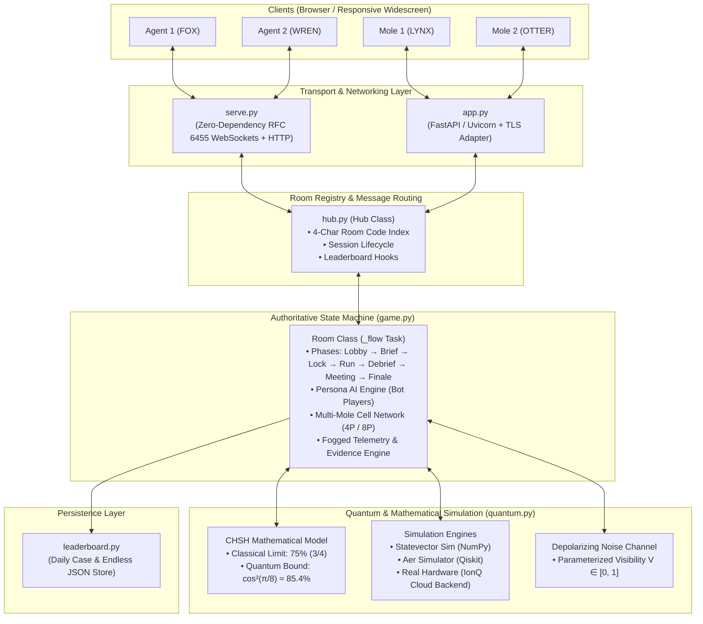
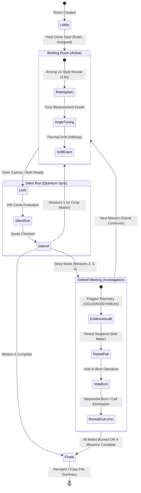
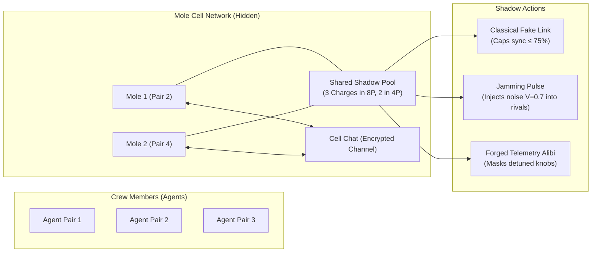

# Twin Signal: Core Backend Architecture & Systems Design

> **Overview**: *Twin Signal* is a real-time, zero-dependency multiplayer espionage game powered by quantum non-locality and Bell's CHSH game. This document details the end-to-end backend architecture, data pipelines, state machine, anti-cheat information boundaries, and quantum physics simulation layers—formatted for engineering documentation and presentation decks.

---

## 1. High-Level System Architecture

The Twin Signal backend is decoupled into four modular layers: **Transport & Ingestion**, **Connection Hub & Registry**, **Authoritative Game State Machine**, and **Quantum Simulation & Physics Engine**.

---

## 2. Component Breakdown

### 2.1 Transport Layer (`serve.py` & `app.py`)
- **Dual-Mode Serving**:
  - **Zero-Dependency Native Server (`server/serve.py`)**: Built strictly with Python standard library (`asyncio`, `struct`, `hashlib`, `base64`). Manages raw TCP sockets via `asyncio.start_server`, performs the RFC 6455 WebSocket opening handshake with SHA-1 GUID hashing, decodes 7-bit/16-bit/64-bit frame lengths, and handles client frame unmasking.
  - **Production ASGI Server (`server/app.py`)**: Thin FastAPI wrapper sharing the exact same `Hub` instance, allowing reverse-proxy termination (NGINX/Caddy) with TLS for `wss://`.

### 2.2 Hub & Room Registry (`hub.py`)
- **Room Code Allocation**: Random non-colliding 4-character uppercase alphanumeric strings (`[A-Z0-9]`, excluding ambiguous characters like `0`, `O`, `1`, `I`).
- **Connection Multiplexing**: Tracks socket-to-room mappings. When connections drop, cleans up rooms when empty, or marks player disconnected while keeping room state intact.
- **Leaderboard Integration**: Intercepts game completions and submits results to daily and endless leaderboards.

### 2.3 Authoritative Game State Machine (`game.py`)
The game loop runs as a decoupled asynchronous coroutine (`_flow()`):

#### The Seven Core Phases:
1. **Lobby**: Players join; bots backfill vacant seats; game settings selected (4P, 8P, Daily, Endless).
2. **Role Reveal Splash**: Zero-latency cinematic reveal (`AGENT` vs `MOLE` vs `AGENTS CO-OP`).
3. **Briefing (`brief`)**: Tuning angle knobs ($0$ to $4$ snaps); real-time quantum sync gauges calculated and broadcast; chat enabled; mole sabotage actions available (Cheat, Jam).
4. **Lock (`lock`)**: Knobs freeze; card pairs shuffled and pre-calculated.
5. **Silent Run (`run`)**: High-speed automated 200-round CHSH game; chat disabled; players observe local card and door choice.
6. **Debrief (`debrief`)**: Quota evaluation, star rating calculation, link on vs. off race replay generated.
7. **Meeting (`meeting`)**: Energy tokens spent; suspect pair telemetry re-tested; alibis inspected; majority voting to burn suspected moles.

---

## 3. Quantum Physics & Mathematical Engine (`quantum.py`)

### 3.1 The CHSH Non-Locality Game
The backend implements the Clauser-Horne-Shimony-Holt (CHSH) game:
- Two isolated agents (Alice and Bob) receive independent random input bits: $x, y \in \{0, 1\}$ (represented as **BLUE** = 0, **RED** = 1).
- Each agent must output a bit: $a, b \in \{0, 1\}$ (Door **LEFT** = 0, **RIGHT** = 1).
- **Winning Condition**:
  $$a \oplus b = x \land y$$
  *(Different doors required only when both receive RED cards; same doors required otherwise).*

### 3.2 The Classical vs. Quantum Boundary
- **Classical Upper Bound (Bell's Theorem)**:
  Under local hidden variables / classical pre-shared strategies, any team can win at most 3 of the 4 card combinations:
  $$P_{\text{classical}}(\text{win}) \le 75.0\% \quad (3/4)$$
- **Tsirelson's Bound (Quantum Limit)**:
  Using maximally entangled Bell pairs $|\Phi^+\rangle = \frac{|00\rangle + |11\rangle}{\sqrt{2}}$ with optimal measurement angles:
  $$\theta_A(0) = 0, \quad \theta_A(1) = \frac{\pi}{4}, \quad \theta_B(0) = \frac{\pi}{8}, \quad \theta_B(1) = -\frac{\pi}{8}$$
  The win probability reaches:
  $$P_{\text{quantum}}(\text{win}) = \cos^2\left(\frac{\pi}{8}\right) \approx 85.355\%$$

### 3.3 Noise Model
The quantum engine applies a depolarizing noise channel parameterized by visibility $V \in [0, 1]$:
$$P(\text{win} \mid x, y) = V \cdot \cos^2(\theta_A(x) - \theta_B(y)) + \frac{1 - V}{2}$$

---

## 4. Multi-Mole Deception Architecture (4P & 8P Networks)

### Key Technical Mechanisms:
1. **Shared Shadow Pool**: Moles draw from a shared charge pool ($2$ in 4P, $3$ in 8P). Spending a charge coordinates sabotage between cell partners.
2. **RF Jamming**: Moles can target any other pair during briefing. The server injects depolarizing noise into the target pair's quantum circuit, causing innocent agents to produce poor telemetry.
3. **Forged Alibis**: Broadcasts a synthetic `TUNED` telemetry status to crew members during debrief meetings, while fellow moles see `[FORGED]` tags.
4. **Sequential Elimination (8-Player)**: Burning the first mole triggers a `"ONE CELL DOWN"` event. The game does not conclude until both moles are eliminated.

---

## 5. Security & Zero-Knowledge Anti-Cheat Boundaries

To ensure fairness in competitive gameplay, the backend strictly isolates state:

| Data Type | Server State | Transmitted to Client | Prevention / Guarantee |
| :--- | :--- | :--- | :--- |
| **Mole Identity** | `seat.role = 'mole'` | **Never broadcast** until formal burn event | Inspecting WebSocket frames cannot reveal the mole. |
| **Shadow Pool** | `self.shadow` | Only sent to connections where `seat.role == 'mole'` | Crew clients cannot see remaining sabotage charges. |
| **Partner Knobs** | `seat.knobs = [k0, k1]` | **Never sent** to partner; only resultant sync gauges are sent | True angle settings remain secret; prevents copycat tuning. |
| **Card / Door Stream** | Generated at LOCK | Only client's own card & door sent in real-time | Prevents bots or players from calculating peers' round outcomes. |
| **Cell Chat** | `scope: 'mole'` | Masked and routed strictly to `self.moles` conns | Agents receive zero websocket packets from mole discussions. |
| **Evidence Coarsening**| Raw exact floats | Rounded to nearest 2% + tags (`SOLID`, `NOISY`, `WEAK`) | Eliminates statistical p-value cheat scripts. |

---

## 6. Presentation Slide Mapping (For Deck / PPT)

Use these 8 slides to summarize the architecture in project presentations:

* **Slide 1: Executive Overview** — Twin Signal concept, combining quantum CHSH entanglement games with social deduction.
* **Slide 2: System Architecture** — 4-tier modular stack (Native WebSockets, Room Hub, Authoritative State Machine, Quantum Engine).
* **Slide 3: Physics & Math Engine** — Bell's theorem, classical wall ($75\%$) vs Tsirelson's bound ($85.4\%$).
* **Slide 4: State Machine Lifecycle** — Asynchronous flow from Lobby $\to$ Role Reveal $\to$ Briefing $\to$ Silent Run $\to$ Debrief $\to$ Meeting.
* **Slide 5: Multi-Mole Deception Network** — 4P (1 mole) and 8P (2 moles in cell network) topologies with shared shadow pool.
* **Slide 6: Zero-Knowledge Security** — Asymmetric websocket broadcast guarantees and information hiding.
* **Slide 7: Bot Persona AI** — Heuristic-driven tuning, social chat generation, and voting behaviors.
* **Slide 8: Performance & Verification** — 100% test pass rate across 34 asynchronous end-to-end test suites.
